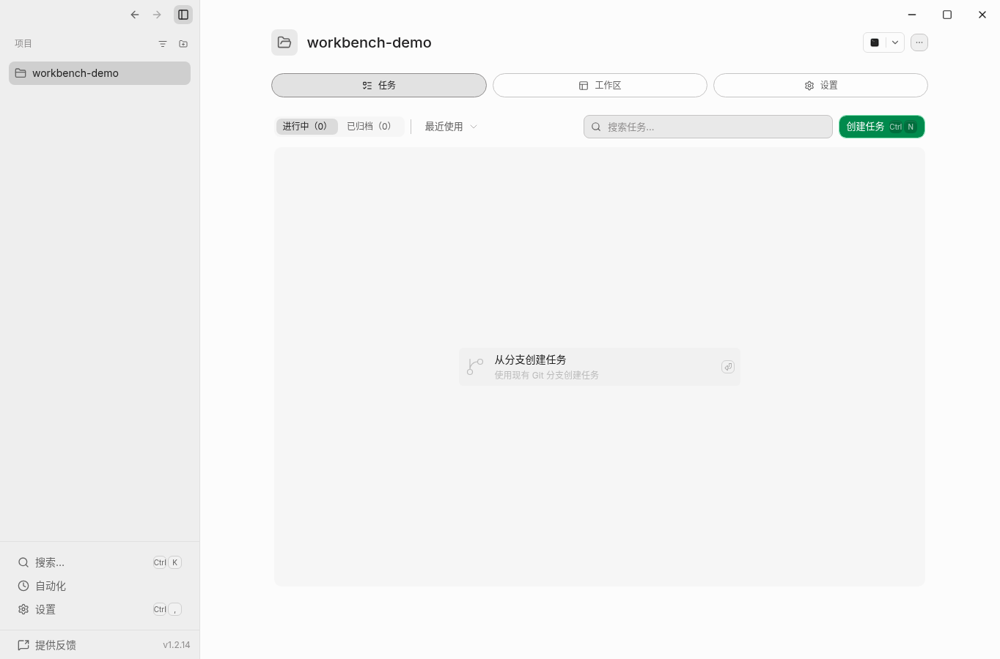

# Emdash Classic

Emdash Classic 是一款开源桌面应用，可在本机的独立 Git 工作树中并行运行 Claude Code、Codex、OpenCode 等编程智能体，支持 macOS、Windows 和 Linux。

<div align="center">

[发行版](https://github.com/coooold/emdash/releases) · [下载源码（ZIP）](https://github.com/coooold/emdash/archive/refs/heads/main2.zip) · [问题反馈](https://github.com/coooold/emdash/issues) · [参与贡献](CONTRIBUTING.md)

</div>



## 当前分支的功能

- 无需 Emdash 账号即可打开本地项目、通过 URL 克隆仓库，以及查看和提交 Git 改动。应用内登录与依赖账号的议题和拉取请求集成已移除。
- 在独立的 Git 工作树和分支中并行运行多个智能体，可直接在应用内管理任务和终端。
- 开发任务、工作区和应用预览均在本机运行。SSH 远程开发与端口转发已移除。已有的 SSH 项目会显示为不可用，可手动移除本机记录。
- 首页、菜单、项目、任务、设置、编辑器、终端和聊天的主要界面采用简体中文。

## 安装

安装包发布后可在 [GitHub Releases](https://github.com/coooold/emdash/releases) 下载。当前可 [下载 `main2` 源码（ZIP）](https://github.com/coooold/emdash/archive/refs/heads/main2.zip)，或通过 Git 获取源码后自行构建。

### 从源码构建

在 Linux 下检出 `main2` 后，在仓库根目录运行以下命令。安装包生成在 `apps/emdash-desktop/release/`。

```bash
pnpm install
pnpm exec nx build @emdash/emdash-desktop
pnpm --dir apps/emdash-desktop run package:linux
```

### 自动发布

GitHub Actions 会为 Linux x64 和 ARM64、Windows x64、macOS Apple Silicon 构建安装包。可在 `main2` 手动运行工作流，安装包会保存在该次运行的 Artifacts 中。[Package and release desktop](https://github.com/coooold/emdash/actions/workflows/release-desktop.yml)

正式发行时，在 `main2` 提交 `apps/emdash-desktop/package.json` 的版本改动，把提交和对应的 `vX.Y.Z` 标签推送到仓库。所有平台打包成功后，工作流会发布 GitHub Release，并附带 `SHA256SUMS` 校验文件。

```bash
version=$(node -p "require('./apps/emdash-desktop/package.json').version")
git push origin main2
git tag "v$version"
git push origin "v$version"
```

Windows 安装包未使用可信代码签名证书，macOS 安装包使用临时签名。首次安装可能出现系统安全提示。

## 智能体

应用会检测本机已安装的智能体命令行工具，并沿用现有配置。若服务商要求认证，请通过对应的命令行工具完成配置。

对于支持生命周期钩子的智能体，应用会在其用户配置中添加带标记的条目。这些钩子用于跟踪状态、发送通知和恢复会话，只在应用启动的会话中生效。

可在「设置 → 智能体」查看应用已检测到的工具和配置。

## 隐私

应用采用本地优先方式，将应用状态保存在本机的 SQLite 数据库中。代码和聊天内容不会发送到 Emdash 服务器。

智能体命令行工具可能会将代码、提示和上下文发送给各自的服务商。数据处理方式取决于所选的服务商。

此版本已移除 Emdash 自身的使用统计与遥测上报。

## 参与贡献

欢迎参与贡献。开发和测试流程见 [贡献指南](CONTRIBUTING.md)。遇到问题或有功能建议，可以 [提交议题](https://github.com/coooold/emdash/issues)。

## 许可证

本项目采用 [Apache-2.0 许可证](LICENSE.md)。
